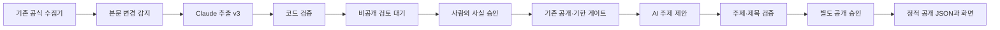

# 수집·AI 검토·주제 카드·일일 실행 연결

상태: 사용자 승인4일 운영의 실제 수집·AI 검토 대기·공개 snapshot 전달·Pages 배포·390/1440 화면 검증을 완료했다. 정기 등록은 root 소유 LaunchAgents 폴더의 파일 설치 권한 때문에 사용자 설치를 기다린다. 전체 목표는 아직 미완료다.



## 명령과 승인 경계

기존 수집 명령의 기본 경로는 무료 수집만 수행한다. AI 단계는 명시적으로 선택한다.

```sh
python3 -m benefit_monitor.cli --online --ai-review --ai-max-candidates 2
```

이 명령은 공식 본문을 읽고 입력을 준비하지만 API를 호출하지 않는다. 이번 일회 실험 안에서 실제 생성까지 허용하려면 `--ai-allow-spend`를 별도로 지정한다. 모든 실행은 동일한 `.tools/claude-trial/live/budget.json`을 사용한다. 하위 시험 runtime을 만들어도 별도 API 원장을 만들지 않는다.

HTTP 수집의 `cost_policy`는 공식 페이지 수집만 기록한다. Claude 사용 여부는 `ai_review.api_spend_requested`, 실제 사용량·비용은 별도 누적 원장으로 확인한다. 무료 HTTP telemetry를 전체 작업의 API 무과금 증거로 사용하지 않는다.

검토 결과는 `cache/ai_review/queue/`에 남으며, 계약 통과도 `pending_human_review`다. 공개 승인 파일에 자동 쓰지 않는다. 같은 본문·프롬프트 입력은 재호출하지 않고 작은 후보 한도 안에서 미확인 항목을 순환한다. 중단 후 입력을 동일하게 재사용해 시각 변경 때문에 새 유료 요청이 생기지 않게 한다. 본문 변경 시 기존 승인 항목을 재검토 보류한다.

## 주제 입력과 공개 카드

주제 입력은 기존 `publish.payload`의 읽기 전용 공개 게이트를 통과한 현재 사실에서 만든다. 원문·프롬프트·키·개인 프로필은 주제 입력에 포함하지 않는다. 후보의 공개 승인, 검증 시각·기한·재검토 보류를 재검사한다.

`public/topic-basis.json`은 주제 편집 승인이다. 항목별 편집은 내용 해시에 묶는다. 별도 승인을 받은 category 정책은 이미 사람이 승인한 labels.category의 문화·체험→culture, 교육·강좌→learning, 할인·적립→shopping만 연결할 수 있다. 다른 분류를 취업이나 가족에 임의 연결하지 않는다. 무료/주말/가족 수식은 기본 승인하지 않는다.

`topic_refresh`는 KST 하루1회만 유료 주제 시도를 허용한다. 실패하면 마지막 유효 초안의 현재 ID·claim만 남긴다. 카드 전체에 적용하는 프로필 조건은 별도 검토로 차단하며, 브라우저 개인 설정은 외부로 전송하지 않는다.

`public/topic-publication.json`은 별도 공개 승인이다. 정확한 초안 해시 또는 검토된 정책·편집 근거의 해시에 묶이며 만료시각이 필요하다. 규칙·근거가 바뀌면 정책 승인을 재확인한다. 승인된 카드만 `briefing.json.topic_cards`에 포함된다. 화면은 현재 검증된 항목과 사실이 일치하는 연결만 표시하고, 카드 묶음이 없거나 만료·잘못된 형식이면 기존 주제 규칙으로 복귀한다. 이전 카드가 만료 항목을 부활시키지 않는다.

## 일일 명령과 비활성 계획

```sh
python3 -m benefit_monitor.ai_daily
python3 -m benefit_monitor.ai_activation --output .tools/새-활성화-검토안
```

첫 명령은 기본 dry_run이며 네트워크·API·공개 쓰기를 하지 않는다. 두 번째 명령은 **설치하지 않고** 비활성 설정과 LaunchAgent 검토안을 프로젝트 내부에 만든다.

활성 설정은 `ai-automation.json`이다. enabled, recurring_spend_approved, public_application_approved는 기본 false다. 매일 KST06:00 이후의 첫15분 점검에서 실행하고 하루 중복을 차단한다. 하루 조사 최대2개·주제1회이며 기존 누적 $5·40요청을 초기화하지 않는다. 비정상 종료 후 같은 날 유료 작업을 자동 재시작하지 않는다.

LaunchAgent 설치와 설정 활성화는 현재 하지 않았다. 사용자 요청의 “반복 API 지출·공개 적용은 별도 승인 범위”를 따른다. 실제 배포 전달 경로와 활성화 검토표를 완성한 뒤 구체적 승인을 받는다. 기존 브랜치를 사용하며 main 병합을 하지 않는다.

## 검증과 한계

[전체 목표 실행 기록](evaluations/goal-integration-2026-11-05/README.md). 실제 API 시험은 정확도 평가이며 모델이 모든 조건을 정확하게 추출했다는 증거가 아니다. 조사 초안의 자동 사실 승인·신청·구매·예약은 구현하지 않는다. 기존 robots·TLS·허용 호스트·2MiB·HTTP예산·실패900초·구6시간캐시 정책과 무료 수집기의 기본 금지는 유지한다.

## 원격 전달 검증과 활성화 조건

`remote_delivery`는 공개 승인과 원격 전달 승인을 모두 요구하고, 변경 없는 커밋된 작업 사본만 전달한다. 인증 전에 저장소·작업 브랜치·공개 snapshot을 검사한다. 하위 명령에는 허용한 실행 환경만 전달하며 기존 셸 API 키·GitHub 토큰을 넘기지 않는다. 프로젝트 내부의 개인 토큰이 있으면 소유자·0600 권한·계정 이름을 검사해 사용한다. 없으면 `gh auth token --user Kim-Taesu`로 개인 계정 하나를 지정한다. 실제 API 계정 이름과 공개 저장소 여부를 다시 검사한다. 전역 계정 전환을 하지 않는다.

공개 JSON만 기존 `briefing-data`에 반영하고 반환된 고정 commit SHA와 코드 SHA를 작업 브랜치의 기존 `briefing-pages.yml`에 전달한다. workflow는 프로젝트 코드를 실행하기 전에 요청한 코드 SHA와 체크아웃을 비교한다. 깨끗한 배포 사본은 키·원장·비공개 검토 초안 없이 `public_snapshot`으로 승인 사실·기한·보류 상태·편집 정책을 재검증한다. 오래된 snapshot과 승인 사실 변경은 거절한다. 성공적인 dispatch는 실제 배포 완료로 표시하지 않는다.

실패 상태를 미러링할 때도 기존 원격 보류와 더 최신인 로컬 본문/제목 변경 보류를 유지한다. 원격 복원으로 재검토 대상을 다시 추천하지 않는다.

익명 조회 결과 기존 Pages 환경은 main만 허용한다. main 병합 없이 공개하려면 `docs/ai-research-playbook`을 환경의 허용 브랜치에 추가하는 별도 승인이 필요하다. 로컬·원격 커밋은 공통 조상이 없지만 기준 tree SHA가 동일하다. 승인 후 양쪽 이력을 보존하고 일반 push를 수행하며 강제 push는 사용하지 않는다. [확인 자료](evaluations/goal-integration-2026-11-05/remote-work-comparison.json).

비활성 LaunchAgent 계획은 Python·gh 경로를 명시하고 TMPDIR·로그를 프로젝트 안에 둔다. 설치 전에 프로젝트의 `cache/ai_daily`, `.tools/tmp`를 준비해야 한다. 정기 작업은 이 Mac이 켜져 있고 사용자 세션이 실행 중일 때만 동작하며 실행 시각을 보장하지 않는다. macOS 전역 LaunchAgent 파일 한 개의 설치·등록은 별도 승인에 포함해야 한다.

검토안은 활성화 후4일 한정, 하루 조사 최대2개·주제1회다. 전체 누적40요청 중13회가 남았으므로 최대12회 일일 시도와 최대1회 검증 여유를 제안한다. 기존 실패 예약과 $5 한도를 유지하며 실제 청구·세금·계정 잔액을 보장하는 값으로 표현하지 않는다. `trial_expires_at`과 주제 공개 정책 만료를 활성화 시각에 맞춰 설정한다. 시간 창이5개 달력 날짜에 걸쳐도 일일 시도는 최대4회로 제한한다. 중단하려면 `ai-automation.json`의 enabled를 false로 바꾸며, 이미 공개된 카드는 기존 기한 검사를 계속 받는다.

## 보안 검증 중 발견과 조치

개발 중 한 모의 테스트의 실패 메시지가 상속 셸 환경을 출력해 프로젝트와 무관한 인증정보가 대화에 노출됐다. 생성된 로컬 로그를 삭제했으며 테스트는 가짜 환경만 사용하고 환경 값을 실패 메시지에 출력하지 않도록 수정했다. 실제 원격 전달도 환경 허용목록을 사용한다. 외부 서비스 호출은 모의 처리였고 해당 서비스에 실제 요청하지 않았다. 대화에 노출된 인증정보 교체는 사용자 조치로 남아 있다. 저장소의 비밀 패턴 검사 통과를 이 노출이 없었다는 증거로 취급하지 않는다.

## 활성화 승인과 인증 단계 — 2026-11-05

사용자가4일 한정 검토안에 `ok`로 응답해 반복 지출·공개·지정 LaunchAgent 설치 범위를 승인했다. [승인 기록](evaluations/goal-integration-2026-11-05/activation-approval.json). 개인 계정·공개 저장소·무료 확인 변수·기존 Pages 설정은 인증 조회로 재확인했다. 첫 push는 저장된 OAuth 토큰의 workflow scope 부족으로 GitHub가 거절했다. 이 권한을 우회하지 않는다.

인증 갱신은 프로젝트 내부 `.tools/personal-gh-auth`의 개인 계정 설정만 사용하며 전역 활성 계정을 전환하지 않는다. 새 토큰이 이 설정에 저장되면0600 권한·Git 제외를 유지하고 원격 전달 프로그램이 해당 개인 설정을 선택한다. 일회용 인증 코드·토큰을 공개 문서에 기록하지 않는다. 실제 GitHub 계정 이름과 공개 저장소 여부를 다시 확인한 뒤 push·배포를 이어간다. 현재 스케줄 설치와 실제 공개 반영은 아직 완료되지 않았다.

인증 갱신 과정에서 gh의 이름 지정 조회가 새 로컬 토큰보다 전역 키체인의 옛 토큰을 우선 반환함을 확인했다. 새 개인 토큰의 workflow scope와 실제 계정을 직접 확인하고 Git 제외·0600의 `.tools/personal-gh-auth/token.json`에 저장했다. 프로그램은 이 파일을 우선하며 전역 키체인과 활성 계정을 바꾸지 않는다. 토큰 값은 대화·공개 산출물에 기록하지 않는다.

첫 실제 일일 실행의 승인 항목31개 주제 입력은 보기 좋은 JSON 형식의 파일 크기 제한으로 과금 전에 중단됐다. 다음 입력은 전체 원본을 compact JSON으로 저장한다. 모델 전송에는 모든 항목·요약·조건·기한·편집 근거와 별도 fee_status·payment_terms·benefit_value를 보존하고, 중복 공개 메타데이터만 제외한다. 전체 원본과 원래 claim ID는 로컬 검증에 그대로 사용한다.64kB API 전송 한도는 유지한다. 별도 승인된 검증1회는 실제 응답을 받았지만 잘못된 ID·표준 제목 문제로 거절됐다. 이를 성공으로 바꾸거나 유료 재시도하지 않고 기존 화면 규칙으로 복귀한다.

## 실제 활성화 검증 결과

[전체 실행 기록](evaluations/goal-integration-2026-11-05/activation-result.json). 첫 실제 일일 실행은 공식 HTTP67/설정75회, 공개 JSON43건, AI 조사2건이다. 조사1건은 계약 통과·1건은 거절됐으며 둘 다 pending_human_review로 비공개 대기에만 저장했다. 별도 주제 검증1회도 거절돼 공개 AI 주제는0개이고 기존 화면 주제 규칙으로 복귀했다. 승인 사실 원본은 변경하지 않았다.

[실제 workflow](https://github.com/Kim-Taesu/benefit-monitor/actions/runs/41967802419)의 빌드·배포가 성공했다. 공개 URL의 항목·자치구 관측이 고정 snapshot과 일치하고,390/1440 화면의 실제 초기 데이터도 일치했다. JSON43건 중 기존 서울 베타 범위40건을 표시했으며 문화 카드12건 선택·가로 넘침 없음·화면 오류 없음·외부 API 호출 없음을 확인했다. 나머지3건은 기존 지역 범위 필터에 따른 제외로, 검증 실패나 혜택 종료를 뜻하지 않는다.

기존 main 정기 작업이 오늘 KST06:47에 시작된 점을 확인했다. 새 정기 AI 실행은06:00 이후라도 당일 main 정기 작업이 없거나 진행 중이면 과금·일일 시도 기록 전에 기다린다. 다음15분 점검에서 재확인하고 기존 정기 작업 완료 뒤에 수집·AI·배포를 실행해 작업 브랜치 화면이 뒤늦은 main 배포로 덮이는 순서를 방지한다. GitHub 정기 작업 자체가 실행되지 않는 날에는 자동 공개도 대기하므로 정시 실행을 보장하지 않는다. 이미 완료한 날에는 이 조회도 반복하지 않는다.

누적30요청의 usage 계산액은$0.075924, 이전 실패 예약 포함 예산 점유$0.106768, 보수적 잔여$4.893232·10회다. 기존 전체 상한·실패 예약은 유지한다. 사용자에게 지정된 LaunchAgent 파일 하나만 관리자 권한으로 설치하는 명령을 전달했다. 상위 폴더의 소유권·권한은 변경하지 않았다. 파일 설치 후 등록·첫 중복 차단 실행을 확인해야 전체 완료를 판정한다.
