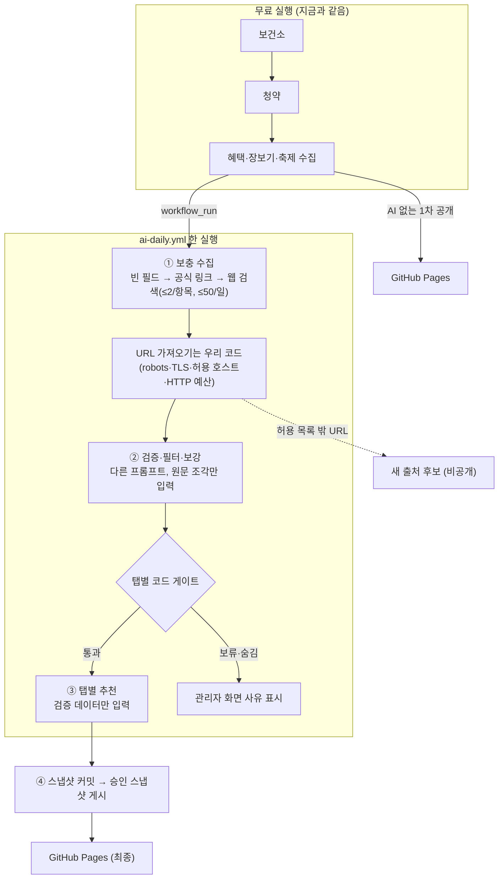

# 4단계 AI 파이프라인 설계안 (v2)

상태: **설계안 — 구현 전**. 2026-11-20 사용자 결정을 반영했다. 정책 문구(`AGENTS.md`, [정책 대응표](policy-map.md), [원 승인 이력](../../AGENTS.history.md))는 구현 PR에서 함께 고친다. 현재 구조는 [실행 구조](../architecture.md)를 본다.

## 목표

사용자가 원하는 흐름:

1. **수집**: 스크립트로 가져오고, 부정확하거나 빠진 부분은 AI가 더 찾아온다.
2. **검증·품질 강화**: 1단계와 다른 AI가 수집 결과를 검증하고 거르고 보강한다. 이 단계가 끝나야 "검증된 데이터"다.
3. **탭별 추천**: 검증된 데이터로만 탭별 추천 코멘트를 만든다.
4. **최종 게시**.

## 2026-11-20 사용자 결정

| 항목 | 결정 |
| --- | --- |
| 1단계 AI 수집 방식 | 공식 링크 따라가기 먼저, 부족하면 **Claude 웹 검색** |
| 2단계 검증 범위 | **모든 탭**: 혜택, 축제, 보건소, 청약, 장보기 |
| AI 없는 1차 공개 | **유지** (스크립트 결과를 먼저 보여 주고 최종 게시로 교체) |
| 웹 검색 상한 | **하루 50회** |
| 월 비용 상한 | **$30** (기존 $15에서 상향, 원장 기준) |
| 검색 결과 신뢰 범위 | **공식 원문 재확인 후만 공개**. 검색은 단서이고, 허용 목록 밖 출처는 "새 출처 후보"로만 남긴다 |

## 지금과 무엇이 달라지나

| 단계 | 지금 | v2 |
| --- | --- | --- |
| 1. 수집 | 스크립트만. AI 추가 조사는 혜택 중 나들이·축제 문구 후보만, 등록된 링크만 따라감 | 모든 탭의 빈 필드에 대해 링크 따라가기 → 부족하면 웹 검색(항목당 최대 2회) |
| 2. 검증 | 혜택만(원문 대조 + `auto_publish` 게이트). 1단계와 같은 호출에서 섞여 있음 | 모든 탭, **별도 요청·별도 프롬프트**. 1단계 모델의 주장은 사실로 넘기지 않고 원문만 넘김 |
| 3. 추천 | 있음. 혜택 말고는 검증 안 된 입력 | 같은 추천, 입력을 검증된 데이터로 바꿈 |
| 4. 게시 | 승인 스냅샷 게시 | 그대로 |

## 흐름

### 단계 경계 규칙

- **단계 사이에는 파일만 넘긴다.** 1단계 결과 `cache/pipeline/enriched.json`(항목별 근거 문서 ID·URL·본문 해시), 2단계 결과 `cache/pipeline/verified.json`(항목별 판정·보강 필드·근거 조각).
- **2단계 입력에는 1단계 모델의 문장을 넣지 않는다.** 스크립트 값과, 우리 코드가 직접 읽은 공식 원문 조각만 넣는다. 그래야 "다른 AI가 검증"이 된다.
- **3단계 입력은 `verified.json`의 통과 항목뿐이다.** AI가 실패한 날에는 지금처럼 규칙 카드로 대체한다.
- **모델은 사실을 만들지 않는다.** 보강 필드는 원문 조각 ID가 있어야 하고, 코드가 그 조각에 값이 실제로 있는지 검사한다.

## 1단계 — 보충 수집

| 탭 | 빈 필드로 보는 것 (코드가 판정) | 따라갈 곳 |
| --- | --- | --- |
| 혜택 | 이용 기간, 대상, 비용, 신청 방법 | 지금의 추가 조사 경로를 모든 혜택 후보로 넓힘 |
| 축제 | 기간, 장소, 요금, 예약 필요 여부 | 축제 상세 페이지 → 주최 기관 공지 |
| 보건소 | 상시 사업의 대상·기간·비용, 공지 본문 핵심 | 보건소 공지 상세 |
| 청약 | 모집공고 원문 링크, 특별공급 세부 일정 | 청약홈 공고 상세 |
| 장보기 | 할인행사 기간·조건·최소 구매액 | 행사 공지 페이지 |

- **링크가 먼저다.** 본문 안에 실제로 있고 허용 목록에 있는 링크로 먼저 채운다(지금 [추가 조사](investigation.md) 규칙 그대로).
- **웹 검색은 링크로 못 채웠을 때만 한다.** 항목당 `max_uses` 2, 하루 합계 50회다. 탭별 몫은 혜택 20, 축제 10, 보건소 10, 장보기 5, 청약 5로 시작하고, 남는 몫은 다른 탭이 쓴다.
- **검색 결과에서 쓰는 것은 URL뿐이다.** 검색 결과 문장은 사실로 쓰지 않는다. 우리 코드가 `OfficialReader`로 그 URL을 직접 읽는다(robots·TLS·리다이렉트·6시간 캐시·실패 대기·HTTP 예산 적용).
- **웹 페치 도구(`web_fetch`)는 쓰지 않는다.** Anthropic 서버가 가져가므로 위 규칙을 거치지 않는다.
- **허용 목록 밖 URL은 읽지 않는다.** 비공개 보고서의 `source_candidates`에만 남긴다. 사람이 `sources/<id>.json`에 등록해야 다음부터 쓰인다.
- **검색 결과는 신뢰할 수 없는 입력이다.** 검색 결과 안의 지시문을 따르지 않도록 프롬프트에 명시하고, 출력은 스키마(URL 목록·요청 필드)로만 받는다.

## 2단계 — 검증·필터·보강

| 탭 | 판정 | 거르는 기준 | 코드 게이트 |
| --- | --- | --- | --- |
| 혜택 | 지금의 원문 대조 + 보강 필드 | 종료, 혜택 아님, 원문 불일치 | 기존 `auto_publish.decide` (기준 완화 없음) |
| 축제 | 소개 글의 요금·취소 구절 대조(구현: `festival_check`) | 취소·연기 구절이 있는 축제 (전국 대상이라 지역으로 거르지 않음) | 구절이 소개 글에 그대로 있어야 하고, 목록 요금 칸과 다를 때만 메모 |
| 보건소 | 생활 관련성 분류, 대상·기간 추출 | 채용·입찰·인사·내부 행정 공지 | 분류만 모델, 숨김은 사유 코드와 함께 관리자 화면에 노출 |
| 청약 | 공고 원문과 일정·세대수 대조 | 일정 불일치(표시는 유지하고 "확인 필요") | 청약홈 값이 기준. 모델은 고치지 않고 불일치만 표시 |
| 장보기 | 할인 조건·기간 확인, 이상값 표시 | 기간 지난 행사 | 가격 숫자는 공시값 그대로. 모델은 바꾸지 않음 |

- **거른 항목은 지우지 않고 숨긴다.** 사유 코드(`ended`, `not_relevant`, `mismatch` 등)와 함께 관리자 화면에서 볼 수 있게 한다. 잘못 숨긴 것을 사람이 찾을 수 있어야 한다.
- **요청은 묶어서 보낸다.** 보건소 131건, 장보기 52건 같은 항목을 20건 안팎씩 한 요청으로 보낸다. 같은 항목·같은 원문 해시면 전날 판정을 재사용한다.
- **실패하면 지금처럼 보인다.** 검증 요청이 실패한 탭은 스크립트 값 그대로 "검증 전" 표시로 두고, 공개 판정이 필요한 혜택만 보류한다.

## 3·4단계

- 축제·혜택·청약·장보기 추천, 보건소 문장, 주제 카드는 그대로 두고 입력만 `verified.json`의 통과 항목으로 바꾼다.
- 게시는 지금의 `publish_snapshot` → `deploy_approved_snapshot` 그대로다.

## 비용과 한도

| 항목 | 하루 상한 | 예상 비용/월 |
| --- | --- | --- |
| 기존 실행(검증 40, 조사 40, 추천·문장 등) | 기존 그대로 | 약 $5 (11-20 실행 61건 × 건당 실제 약 $0.003) |
| 2단계 탭 확장(묶음 요청) | 새 종류 `verify_tab` 20건 | 약 $2 |
| 1단계 웹 검색 | **50회** | 약 $15 (회당 $0.01) |
| 웹 검색 결과 토큰 | — | 약 $2 |
| **합계** | | **약 $24 / 상한 $30** |

- 단가 근거(2026-11-20 공식 문서): Haiku 5.5 입력 $0.10, 출력 $0.50 / 100만 토큰(프롬프트 10만 이하), 웹 검색 1,000회당 $10 + 결과 토큰, 오류 검색 무과금.
- **원장은 검색 비용까지 예약한다.** 요청 전 `max_uses × $0.01`을 토큰 예약에 더해 영속 예약하고, 응답의 `usage.server_tool_use.web_search_requests`로 정산한다.
- **검색 횟수는 따로 센다.** 하루 검색 수를 원장에 기록하고, 50회에 닿으면 검색 없이 링크 결과만으로 진행한다.
- 월 $30에 닿으면 지금처럼 그달 남은 실행을 멈추고, 다음 달에 자동으로 다시 시작한다. 자동 충전은 없다.

## 시간

- AI 실행은 지금 약 12분이다. 검색·검증이 붙으면 25~35분으로 예상한다.
- `ai-daily.yml`의 `timeout-minutes`를 20에서 40으로 올린다.
- 03:20 시작 기준으로 수집이 끝나는 시각이 약 03:48이므로, 04:30 전후에 게시된다. 05:00 마감을 넘기면 cron 시작을 03:00으로 앞당긴다(별도 결정).

## 구현 순서 (PR 단위)

| PR | 내용 | 유료 호출 |
| --- | --- | --- |
| A | 정책 문구 갱신(월 $30, 웹 검색 예외, 새 한도), 원장의 검색 비용 예약·정산·일일 검색 수, 타임아웃 40분 — **구현됨** | 없음 |
| B | 2단계 검증: 보건소 공지 분류·축제 소개 대조(`tab_checks`, 하루 20) — **구현됨**. 청약·장보기는 대조할 두 번째 원문이 없어 C로 옮김 | 검증 묶음 요청 |
| C | 혜택 추가 조사에 웹 검색 보충(링크 없을 때 후보당 1회, 요청당 2회, 하루 50회) — **구현됨**. 검색 URL은 결과 블록에서만, 등록 출처만 읽음. 청약·장보기 검증은 검색이 찾는 두 번째 원문이 대부분 미등록 호스트라, 1주일간 `source_candidates`를 모아 출처를 등록한 뒤 진행 | 웹 검색 |
| C2 | 발굴 검색(2026-11-25 승인): 하루 한 번 지역(서울시·강서구·은평구)·달 단위 검색으로 목록에 없던 행사를 등록 출처 후보로 넣음 — **구현됨**. 같은 하루 50회 안, 요청당 2회 | 웹 검색 |
| D | 3단계 입력을 검증 데이터로 전환, [실행 구조](../architecture.md) 그림 갱신 | 없음 |

B를 C보다 먼저 한다. 검증은 싸고 효과를 바로 잴 수 있으며, C에서 찾아온 자료를 받을 그릇이 먼저 있어야 한다.

## 구현 전에 확인할 것

1. ~~웹 검색과 구조화 출력을 함께 쓸 수 있는지.~~ → 해결: 검색 요청은 응답 형식 강제 없이 보내고 결과 블록의 URL만 쓴다(PR C). 지금 모든 요청이 구조화 출력(스키마)을 쓰고, 문법 크기 제한(`compiled grammar is too large`)에 걸린 적이 있다. 웹 검색은 인용이 항상 켜진다. 같은 요청에서 되는지 작은 유료 시험 1~2건으로 확인한다(사용자 승인 후). 안 되면 검색 요청은 자유 응답 + 우리 코드의 URL 추출로 받는다.
2. **Haiku 5.5의 동적 필터링 지원 여부.** 확실하지 않으면 기본 도구 `web_search_20250305`와 `allowed_callers: ["direct"]`로 시작한다.
3. **Console의 웹 검색 설정.** 조직 설정에서 웹 검색이 꺼져 있으면 400이 난다. 사용자가 Console에서 확인한다.
4. **현재 월 누적 비용.** 암호화 원장의 이번 달 노출액을 `check_only` 실행으로 확인하고 위 추정과 비교한다.

## 측정 (첫 1주)

- 빈 필드 채움률(탭별, 1단계 전후), 웹 검색 1회당 새로 채운 필드 수
- 2단계 숨김 수와 사유 분포, 사람이 되돌린 숨김 수(잘못 거른 비율)
- 하루 비용(토큰·검색 분리)과 게시 시각
- 호출 수 증가만으로 성공이라 평가하지 않는다. 채움률·오숨김·비용을 함께 본다.
