# 실행 구조

매일 새벽 어떤 순서로 무엇이 실행되어 화면에 도착하는지 정리한 문서입니다. 2026-11-20 `main`(PR #74 머지 후) 기준이며, 정책·한도의 원문은 [작업 지침](../AGENTS.md)과 [정책 대응표](ai/policy-map.md)가 우선합니다.

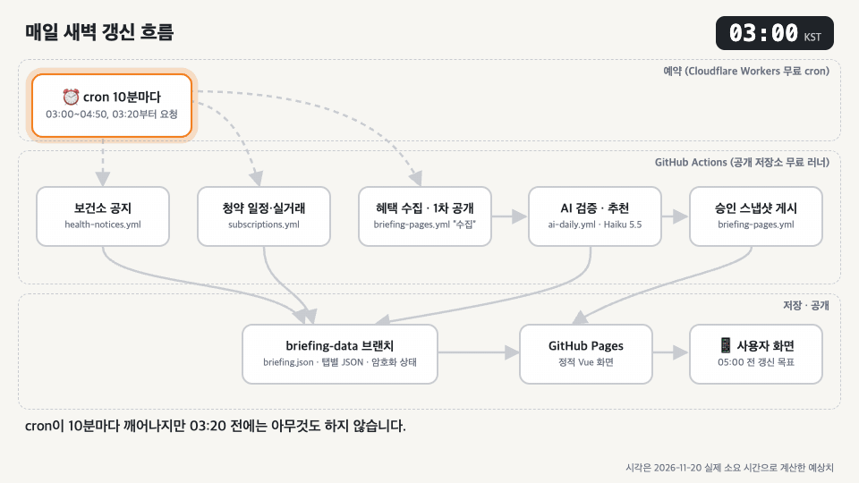

> 그림의 시각은 2026-11-20 실제 실행 소요 시간(보건소 약 2.5분, 청약 약 6.5분, 혜택 수집 약 8분, AI 약 12분, 게시 약 1분)으로 계산한 **예상치**입니다. Cloudflare cron으로 시작하는 첫 실행은 2026-11-21입니다.

## 목차

1. [한눈에 보기](#1-한눈에-보기)
2. [하루 타임라인](#2-하루-타임라인)
3. [무엇이 무엇을 깨우나](#3-무엇이-무엇을-깨우나)
4. [Cloudflare cron의 판단](#4-cloudflare-cron의-판단)
5. [워크플로 한 장 요약](#5-워크플로-한-장-요약)
6. [`briefing-pages.yml`의 네 가지 모드](#6-briefing-pagesyml의-네-가지-모드)
7. [AI 실행 안쪽](#7-ai-실행-안쪽)
8. [혜택 공개 판단](#8-혜택-공개-판단)
9. [데이터 저장소 `briefing-data`](#9-데이터-저장소-briefing-data)
10. [화면이 데이터를 읽는 방식](#10-화면이-데이터를-읽는-방식)
11. [안전장치](#11-안전장치)
12. [수동 실행 입력](#12-수동-실행-입력)
13. [확인하는 방법](#13-확인하는-방법)
14. [이 문서의 그림 갱신](#14-이-문서의-그림-갱신)

---

## 1. 한눈에 보기

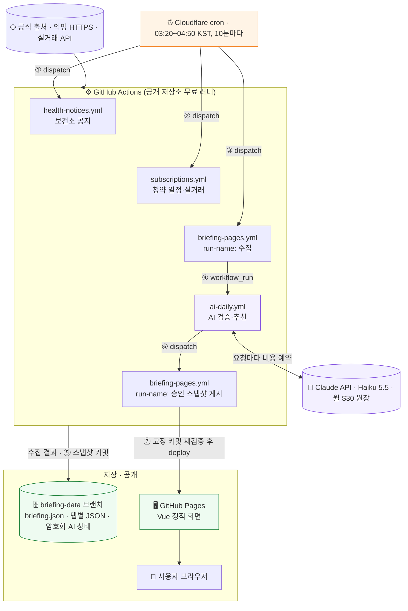

| 층 | 무엇 | 돈 |
| --- | --- | --- |
| 예약 | Cloudflare Workers 무료 cron 1개(`scheduler/cloudflare`) — 워크플로 실행 요청만 함 | 무료 플랜, 결제 정보 없음 |
| 실행 | GitHub Actions 표준 러너 | 공개 저장소 무료 |
| 수집 | Python 표준 라이브러리, 공식 익명 HTTPS | 0 |
| AI | 승인된 Claude 호출만, Haiku 5.5 고정 | 월 $30 원장 상한(2026-11-20 상향, 사용자가 직접 충전) |
| 저장 | 같은 저장소의 `briefing-data` 브랜치 | 0 |
| 공개 | GitHub Pages | 0 |

---

## 2. 하루 타임라인

GitHub `schedule`은 2026-11-08~20 동안 매일 4~8시간 늦게 시작했습니다. 그래서 정시 시작은 Cloudflare cron이 맡고, GitHub 예약은 백업으로만 남았습니다.

```mermaid
gantt
  title 2026-11-20 실제(GitHub 예약) vs 2026-11-21부터 목표(Cloudflare cron)
  dateFormat HH:mm
  axisFormat %H:%M

  section 목표 · Cloudflare
  보건소 · 03시20분 회차       :c1, 03:20, 3m
  청약 · 03시30분 회차         :c2, 03:30, 7m
  혜택 수집 · 03시40분 회차    :c3, 03:40, 8m
  AI 검증·추천                 :c4, after c3, 12m
  승인 스냅샷 게시             :c5, after c4, 2m
  05시 마감                    :milestone, m1, 05:00, 0m

  section 11-20 실제 · GitHub 예약
  예약 시각 00시07~37분         :crit, g0, 00:07, 30m
  늦은 시작 대기                :done, g1, 00:37, 421m
  보건소                       :g2, 07:38, 3m
  청약                         :g3, 07:39, 7m
  혜택 수집                    :g4, 07:44, 8m
  AI 검증·추천                 :g5, 07:52, 12m
  승인 스냅샷 게시             :g6, 08:04, 2m
```

| 작업 | 정시 시작(주) | 백업 | 그날 이미 성공했으면 |
| --- | --- | --- | --- |
| 보건소 `health-notices.yml` | Cloudflare 03:20~ | GitHub 00:07 KST | 게이트에서 수집 없이 종료 |
| 청약 `subscriptions.yml` | Cloudflare (보건소 다음 회차) | GitHub 00:12 KST | 게이트에서 수집 없이 종료 |
| 혜택 수집 `briefing-pages.yml` | Cloudflare (청약 다음 회차) | GitHub 00:37 KST | 게이트에서 수집 없이 종료 |
| AI `ai-daily.yml` | 혜택 수집 성공 직후 `workflow_run` | 06:00~23:45 KST 15분마다 | `already_completed_today`로 종료 |
| 장보기 기준가 `grocery-baselines.yml` | GitHub 매주 일요일 23:07 KST | — | — |

> 게이트는 [`pipeline_timing.gate`](../benefit_monitor/pipeline_timing.py)입니다. 예약 실행(GitHub cron 또는 `external_schedule=true`)만 건너뛰며, 실행 목록을 못 읽으면 그냥 실행합니다(“두 번이 안 하는 것보다 낫다”). 사람이 누른 수동 실행은 게이트를 거치지 않습니다.

---

## 3. 무엇이 무엇을 깨우나

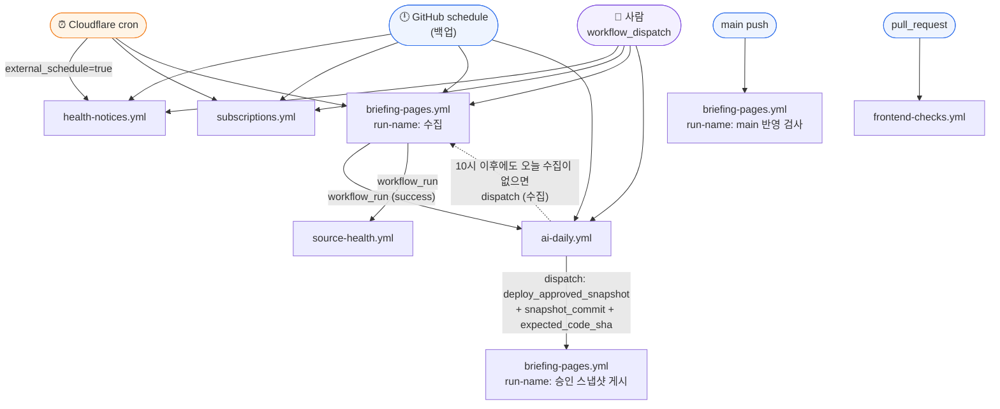

- `ai-daily.yml`은 “오늘 끝난 무료 수집”이 있어야만 유료 작업을 시작합니다. 시계로 막지 않고 수집 완료로 막습니다([`cloud_daily.cloud_run`](../benefit_monitor/cloud_daily.py)).
- 백업 예약으로 AI가 먼저 깨어나도 수집이 없으면 `waiting_for_existing_refresh`로 끝납니다. 10시(`FALLBACK_REFRESH_HOUR`) 이후에도 수집이 없을 때만 수집을 직접 요청합니다.
- `main 반영 검사`(push)는 테스트·빌드만 하고 배포하지 않습니다. 머지만으로는 화면이 바뀌지 않습니다.

---

## 4. Cloudflare cron의 판단

Worker는 10분마다 오늘의 세 워크플로 실행 목록을 읽고, 순수 함수 [`plan.js`](../scheduler/cloudflare/src/plan.js)가 할 일을 정합니다. 한 회차에 최대 하나만 요청합니다.

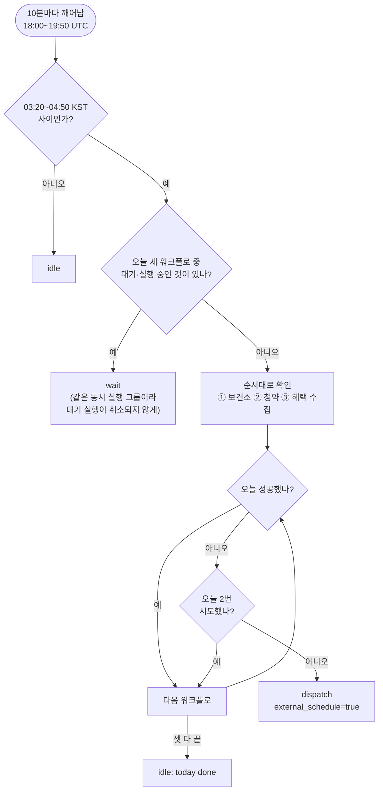

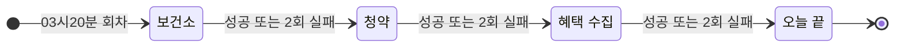

- 혜택 수집 실행은 `run-name`이 `수집`인 것만 셉니다. 같은 파일의 `승인 스냅샷 게시`, `main 반영 검사`는 세지 않습니다.
- 세 워크플로가 `benefit-pages` 동시 실행 그룹을 공유합니다. GitHub는 그룹당 대기 실행을 하나만 두고 이전 대기 실행을 취소하므로, 무엇이든 돌고 있으면 그 회차는 건너뜁니다.
- 끄는 법·토큰 설정은 [`scheduler/cloudflare/README.md`](../scheduler/cloudflare/README.md)에 있습니다.

---

## 5. 워크플로 한 장 요약

| 파일 | 이름 | 트리거 | 동시 실행 그룹 | 주요 명령 | Secret |
| --- | --- | --- | --- | --- | --- |
| `health-notices.yml` | Health notices | Cloudflare · schedule · dispatch | `benefit-pages` | `python -m benefit_monitor.health_notices` | — |
| `subscriptions.yml` | Subscriptions | Cloudflare · schedule · dispatch | `benefit-pages` | `python -m benefit_monitor.subscriptions` | `REAL_ESTATE_TRANSACTION` |
| `briefing-pages.yml` | Daily benefit briefing | Cloudflare · schedule · dispatch · push | `benefit-pages` | `mirror --restore` → `cli --online` → `publish` → Pages 배포 | — |
| `ai-daily.yml` | AI daily trial | `workflow_run` · schedule · dispatch | `benefit-ai-daily` | `python scripts/run_ai_cloud.py` | `ANTHROPIC_API_KEY`, `BENEFIT_AI_STATE_IDENTITY` |
| `source-health.yml` | Source health | `workflow_run` · dispatch | — | `python -m benefit_monitor.source_check` | — |
| `grocery-baselines.yml` | Grocery baselines | 주간 schedule · dispatch | `benefit-pages` | `python -m benefit_monitor.grocery_baselines` | — |
| `frontend-checks.yml` | Frontend P0 checks | pull_request · dispatch | `frontend-p0-<ref>` | Python 회귀 · `plan.test.js` · `npm test/build` · E2E | — |

모든 실행 job은 `github.event.repository.private == false && vars.BENEFIT_PAGES_ZERO_SPEND == 'confirmed'` 조건이 붙어 있어 비공개 저장소(유료 분 사용 가능성)에서는 돌지 않습니다.

---

## 6. `briefing-pages.yml`의 네 가지 모드

같은 파일이 입력에 따라 다른 일을 합니다. `run-name`으로 구분합니다.

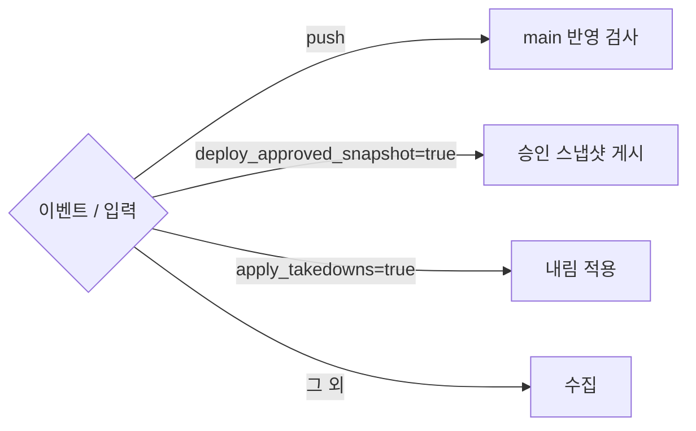

| 단계 | 수집 | 승인 스냅샷 게시 | 내림 적용 | main 반영 검사 |
| --- | :-: | :-: | :-: | :-: |
| gate (오늘 이미 성공했으면 건너뜀) | 예약일 때만 | — | — | — |
| 요청한 코드 SHA와 checkout 일치 확인 | — | ✅ | — | — |
| 출처 정책·Python 테스트·프런트 테스트/빌드 | ✅ | ✅ | ✅ | ✅ |
| `mirror --restore` → `cli --online` → `publish` | ✅ | — | — | — |
| 수집 스냅샷 암호화 업로드(AI 실행이 재사용) | ✅ | — | — | — |
| AI 승인 목록 재확인 저장(`mirror --save-ai`) | ✅ | — | — | — |
| 고정 커밋 재검증 후 내보내기(`public_snapshot`) | — | ✅ | — | — |
| 공개 브리핑에서 내린 항목만 제거 | — | — | ✅ | — |
| 실패하면 이전 추천 대신 실패 상태 공개 | ✅ | ✅ | — | — |
| `briefing-data`에 공개 JSON 미러 | ✅ | — | — | — |
| `assemble_pages.py` → GitHub Pages 배포 | ✅ | ✅ | ✅ | — |

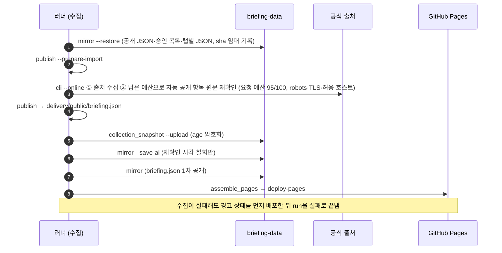

---

## 7. AI 실행 안쪽

`ai-daily.yml` → [`scripts/run_ai_cloud.py`](../scripts/run_ai_cloud.py) → [`cloud_daily.cloud_run`](../benefit_monitor/cloud_daily.py) → [`ai_daily.daily`](../benefit_monitor/ai_daily.py) 순서입니다.

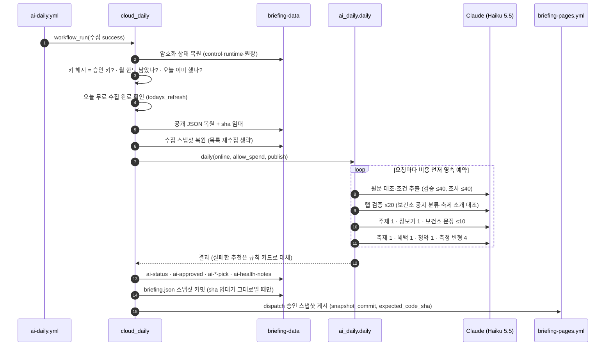

하루 최대 Claude 요청 수(정규 실행 기준, 승인된 한도):

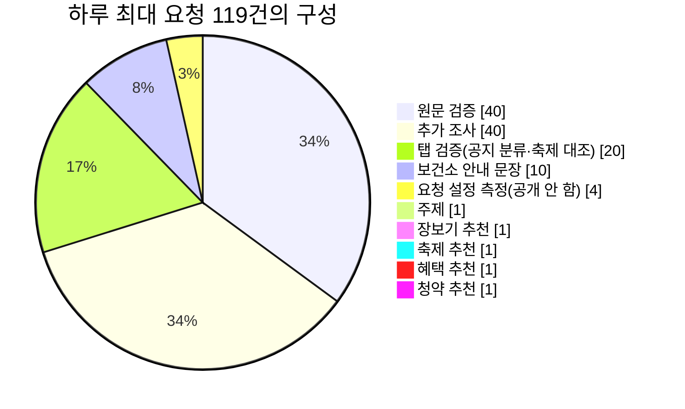

| 결과 상태 | 뜻 | 다음 |
| --- | --- | --- |
| `completed` | 오늘 일을 끝내고 스냅샷 게시 요청 | 게시 run이 Pages 배포 |
| `completed_with_provider_failure` | 일부 요청 거절·실패, 받은 결과는 게시 | 관리자 화면 `ai_status=failed` |
| `credit_exhausted` | 크레딧 소진, 받은 결과만 게시 | 다음 날 정상 실행 |
| `already_completed_today` | 오늘 이미 완료 | 아무것도 안 함 |
| `waiting_for_existing_refresh` | 오늘 무료 수집이 아직 없음 | 수집 완료 후 `workflow_run`으로 다시 |
| `refresh_dispatched` | 10시 이후에도 수집이 없어 직접 요청 | 수집 완료가 다시 이 워크플로를 깨움 |
| `trial_budget_limit` | 월 상한 도달 | 다음 달 자동 재개 |
| `ai_approval_merged_deferred` | 다른 실행과 승인 목록이 병합됨 | 다음 수집이 공개 |

---

## 8. 혜택 공개 판단

모델은 사실을 고치거나 승인하지 않습니다. 코드 게이트를 모두 통과해야만 자동 공개되고, 하나라도 걸리면 보류합니다.

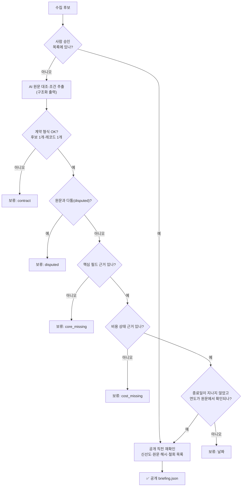

- 판정 코드: [`auto_publish.decide`](../benefit_monitor/auto_publish.py), 철회·재확인: [`auto_release.py`](../benefit_monitor/auto_release.py).
- 매일 재확인(최대 20건, 6시간 안에 확인한 항목은 건너뜀)은 AI 실행에서 AI 검증·조사보다 **먼저** 돕니다. AI 실행은 수집 스냅샷을 재사용하므로 수집 요청이 없습니다. 수집 실행은 예산 95회를 거의 다 쓰므로 수집 뒤 남은 예산으로만 재확인합니다. 이미 공개된 항목은 마지막 확인 뒤 30시간이 지나면 화면에서 빠지고, 예산이 모자라 확인하지 못한 항목은 `report.json`의 `body_check_failures`에 `budget_exhausted`로 남습니다. 2026-11-22에는 두 번 바뀌었습니다. 재확인이 맨 뒤에 있을 때는 예산이 바닥나 공개 기간이 남은 항목들이 빠졌고, 수집 실행에서도 맨 앞으로 옮겼더니 축산물 마지막 5개 부위가 빠졌습니다.
- 축제·장보기·보건소·청약은 검증 혜택과 다른 별도 채널입니다. 모델 문장은 승인된 필드(`grocery_pick`, `health_notes[].sentence`, `festival_pick`, `benefit_pick`, `subscription_pick`)에만 “AI 작성” 표시와 함께 들어가고, 실패하면 규칙 카드·링크로 대체합니다.

---

## 9. 데이터 저장소 `briefing-data`

실행 사이의 상태는 같은 저장소의 `briefing-data` 브랜치에 파일 단위로 커밋합니다(GitHub Contents API, sha로 동시 쓰기 감지).

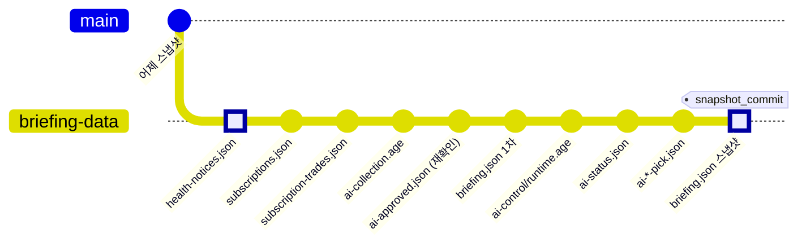

| 파일 | 쓰는 쪽 | 읽는 쪽 | 공개 |
| --- | --- | --- | --- |
| `briefing.json` | 혜택 수집(1차), AI 실행(스냅샷) | 수집·AI 복원, source-health, 게시 run | ✅ 화면 데이터 |
| `health-notices.json` | health-notices | 수집 시 병합 | ✅ (briefing에 포함) |
| `subscriptions.json`, `subscription-trades.json` | subscriptions | 수집 시 병합, 청약 추천 | ✅ (briefing에 포함) |
| `grocery-baselines.json` | grocery-baselines | 수집 시 병합 | ✅ (briefing에 포함) |
| `ai-approved.json` | 수집(재확인·철회), AI 실행 | 수집·AI | 공개 가능한 필드만 |
| `ai-*-pick.json`, `ai-health-notes.json` | AI 실행 | 수집 시 병합(유효기간 검사) | ✅ “AI 작성” 표시 |
| `ai-tab-checks.json` | AI 실행 | 수집 시 병합(공지·축제 묶음과 재대조) | ✅ 접힌 행정 공지·축제 요금 메모 |
| `ai-status.json` | AI 실행 | 관리자 화면·briefing | 상태 문자열만 |
| `ai-control.age`, `ai-runtime.age`, `ai-collection.age` | AI 실행·수집 | AI 실행 | ❌ age 암호화(원장·검토 대기 자료) |

---

## 10. 화면이 데이터를 읽는 방식

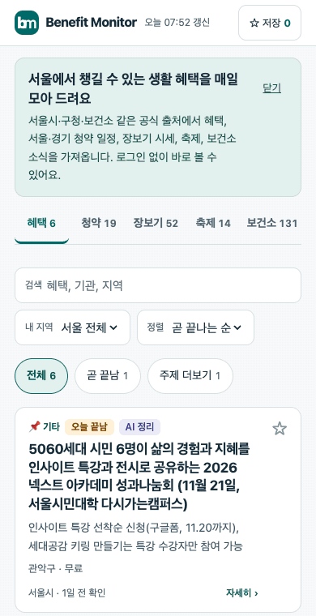

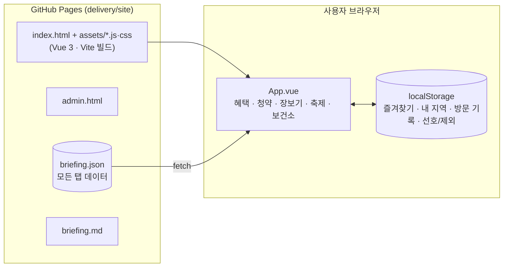

- 사이트에는 빌드 산출물과 `briefing.json`·`briefing.md`만 올라갑니다([`assemble_pages.py`](../scripts/assemble_pages.py)). 서버 코드·API는 없습니다.
- 개인 정보(즐겨찾기·내 지역·반응)는 브라우저 안에만 있고 서버로 보내지 않습니다. 자세한 범위는 [브라우저 저장 범위](ai/personalization.md).
- 새 공개 전까지 이전 목록을 “○○ 기준” 안내와 함께 보여 주고, 공개되면 `pipeline_timing`(크롤링·AI·게시 소요 시간)을 한 줄로 보여 줍니다.

---

## 11. 안전장치

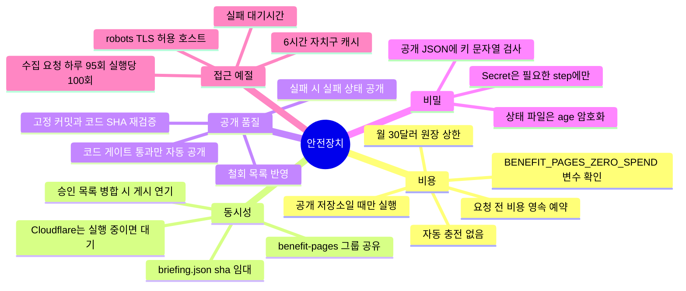

---

## 12. 수동 실행 입력

| 워크플로 | 입력 | 하는 일 |
| --- | --- | --- |
| `briefing-pages.yml` | (없음) | 수집 한 번 더. 실행 이름 `수집` |
| | `deploy_approved_snapshot` + `snapshot_commit` + `expected_code_sha` | 승인된 고정 스냅샷 재검증 후 배포. **보통 AI 실행이 자동으로 요청하며 사람이 임의로 다시 누르지 않습니다** |
| | `apply_takedowns` | 내림 목록만 현재 공개 브리핑에 적용해 재배포 |
| | `external_schedule` | Cloudflare가 쓰는 표식. 오늘 이미 성공했으면 건너뜀 |
| `ai-daily.yml` | `check_only` (기본 켬) | 복원·Secret·원격 저장만 검증, Claude 호출 없음 |
| | `investigate_missing_conditions` (기본 켬) | 누락 조건 추가 조사 |
| | `refresh_completed_day` | 완료된 오늘을 한 번 더 실행(원장 보존) |
| | `retry_rejected_day` | 오늘 요청이 모두 무과금 4xx 거절이었을 때 한 번 재시도 |
| | `close_unresolved_reservation` | 결과가 없는 비용 예약을 쓴 것으로 닫고 오늘을 다시 실행 |
| | `resume_reviewed_halt` | 사람이 원인을 확인한 뒤 중단 해제 |
| | `grammar_probe_only` | 스키마 문법 컴파일만 시험(유료 1건 미만) |
| `health-notices.yml`, `subscriptions.yml` | `external_schedule` | Cloudflare가 쓰는 표식 |
| `frontend-checks.yml` | `check_ai_cloud` | 승인된 AI 전환의 무과금 Secret·원장 검증 |

복구 입력의 세부 조건은 [정책 대응표](ai/policy-map.md)에서 원 승인 조항을 확인합니다.

---

## 13. 확인하는 방법

| 무엇을 | 어떻게 |
| --- | --- |
| cron이 깨어나는지 | `scheduler/cloudflare`에서 03:20~04:50에 `npx --yes wrangler@4.156.0 tail` → 회차마다 `{"action":"dispatch"...}` |
| 순서대로 돌았는지 | `gh run list --limit 10` → `Health notices` → `Subscriptions` → `수집` → `AI daily trial` → `승인 스냅샷 게시` |
| 화면 데이터가 오늘 것인지 | `python3 -m benefit_monitor.live_check` (배포 전후 비교, [verify 스킬](../.claude/skills/verify/SKILL.md)) |
| 출처 실패 | `Source health` run 요약, 수집 run의 Step Summary(출처 ID·유형만) |
| 화면 | 홈 위쪽 “오늘 데이터 준비 …” 줄의 크롤링·AI·게시 시간 |

---

## 14. 이 문서의 그림 갱신

GIF 원본은 [`architecture/src`](architecture/src)에 있습니다. 실행 구조가 바뀌면 `pipeline.html`의 `STEPS`를 고친 뒤 다시 만듭니다. 시스템 Chrome과 저장소의 Playwright, `ffmpeg`를 사용합니다.

```sh
OUT="$PWD/.tools/verification-tmp/gif"; mkdir -p "$OUT/pipe" "$OUT/site"
node docs/architecture/src/capture.cjs "$PWD/frontend/node_modules/playwright" "$OUT"
# 프레임 → GIF (예: 파이프라인, 프레임당 1.8초)
ffmpeg -y -framerate 1/1.8 -i "$OUT/pipe/f%02d.png" \
  -vf "fps=10,split[a][b];[a]palettegen=max_colors=128[p];[b][p]paletteuse=dither=bayer" \
  -loop 0 docs/architecture/daily-pipeline.gif
```

Mermaid 그림은 GitHub에서 바로 렌더링됩니다. 시각·한도 숫자는 코드([`plan.js`](../scheduler/cloudflare/src/plan.js), 워크플로 `cron`, [`AGENTS.md`](../AGENTS.md))와 함께 고칩니다.
